

# DUB STATION

### Live dub mixing station — entirely in your browser

**Version 1.0**

    

Two players, a 4-band kill-switch isolator, a dub filter, a tape echo, a reverb,
a 12-preset dub siren, a 12-pad sampler, a mic channel, graphic EQ and recording —
one single HTML file, no install, no server, no account.

**[OPEN IN YOUR BROWSER](https://altessproduction.github.io/DUBSTATION/)** &nbsp;·&nbsp; **[DOWNLOAD THE HTML FILE](https://github.com/altessproduction/DUBSTATION/releases/download/v1.0/DubStation.V1.0.html)** &nbsp;·&nbsp; **[INSTALL AS A DESKTOP APP](#open-download-or-install-it)**

 

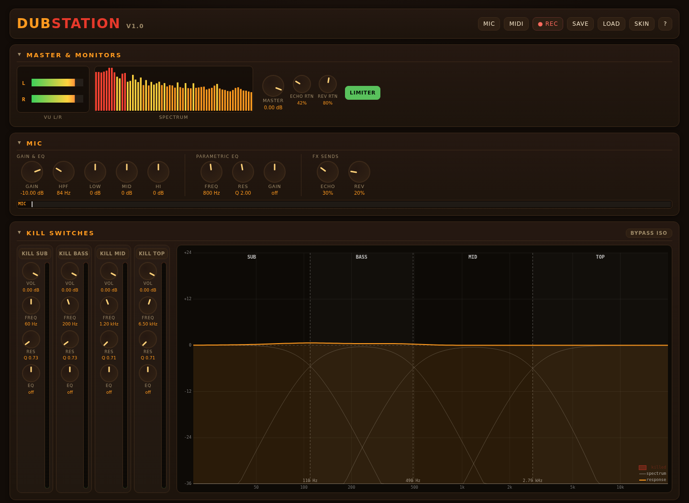

---

## Table of contents

1. [Overview](#overview)
2. [Open, download or install it](#open-download-or-install-it)
3. [Folding interface](#folding-interface)
4. [Quick start](#quick-start)
5. [Channels & crossfader](#channels--crossfader)
6. [Kill switches — 4-band ISO filter](#kill-switches--4-band-iso-filter)
7. [Dub filter](#dub-filter)
8. [Tape echo](#tape-echo)
9. [Reverb](#reverb)
10. [Master & monitors](#master--monitors)
11. [Dub siren](#dub-siren)
12. [Sampler](#sampler)
13. [Mic](#mic)
14. [10-band graphic EQ](#10-band-graphic-eq)
15. [Classic dub flow](#classic-dub-flow)
16. [Keyboard shortcuts](#keyboard-shortcuts)
17. [MIDI](#midi)
18. [Presets & saving](#presets--saving)
19. [Built-in help](#built-in-help)
20. [Privacy](#privacy)

---

## Overview

Live dub mixing station: two players with playlists, pull-up rewind and line inputs
LINE 1 / LINE 2, **4 kill switches** on 4 true ISO bands (frequency / resonance /
parametric EQ / per-band volume — total cut), dub filter, **tape echo** (tape
saturation, wow & flutter, resonant filter, second filter), reverb (room, HF
damping), **12-preset dub siren** with bitcrusher, chop and echo/reverb sends,
12-pad sampler with HP filter, mic with HP filter, low/mid/high EQ and parametric
filter, per-player channel EQ, 10-band graphic EQ, crossfader, recording.

Everything runs in your browser — no file ever leaves your machine.

## Open, download or install it

Three ways to get the station on your machine:

### Open — play right now

**[https://altessproduction.github.io/DUBSTATION/](https://altessproduction.github.io/DUBSTATION/)**

The app is hosted on GitHub Pages: click the link, press **POWER ON**, play.
Nothing to install, nothing to download — and the browser remembers your settings
between sessions.

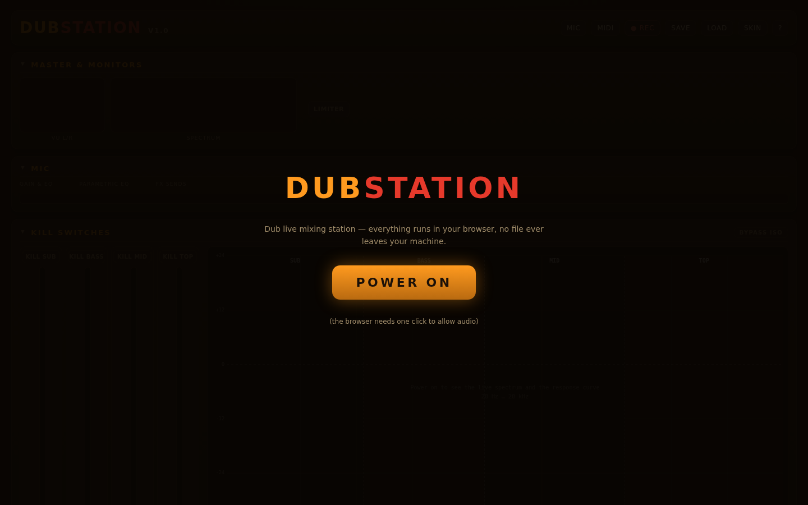

### Download — one file, works offline

Get **`DubStation V1.0.html`**, the whole application in a single file:

- Direct download: **[DubStation.V1.0.html — release v1.0](https://github.com/altessproduction/DUBSTATION/releases/download/v1.0/DubStation.V1.0.html)**
- Whole repository as a ZIP: **[main.zip](https://github.com/altessproduction/DUBSTATION/archive/refs/heads/main.zip)**
- Or clone it: `git clone https://github.com/altessproduction/DUBSTATION.git`

Save the file anywhere, double-click it: it opens in your browser and runs fully
offline. No install, no build, no server — the page is the application.

### Install — as an app on your desktop

DubStation ships with a web app manifest and its own icons, so Chromium browsers
(Chrome, Edge, Brave, Opera…) install it like a native application:

1. Open the hosted app: **[https://altessproduction.github.io/DUBSTATION/](https://altessproduction.github.io/DUBSTATION/)**
2. Click the **install icon** at the right end of the address bar — or open the
   browser menu (⋮) and choose **Install DubStation…** / **Install app**.
3. Done: DubStation opens in its own window with no browser bars, gets its own
   icon in your taskbar / dock / start menu and a desktop shortcut. It launches
   from the desktop like any other program.

Other browsers:

- **Edge** (Windows): same install icon, or Settings → Apps → *Install this site as an app*.
- **Safari** (macOS Sonoma 14 and later): open the app, then **File → Add to Dock** —
  DubStation docks like a real app.
- **Firefox** does not install web apps: download the HTML file above instead —
  it is fully self-contained and works offline from any folder.

## Folding interface

Each module folds down to its title bar: click the title — the chevron on the left
switches from a down triangle to a right triangle — and click again to unfold. The
Players module holds both players: the whole module or each player alone can be
folded separately.

Folding is purely visual: sound and settings keep running. Each module's folded
state is remembered by the browser: when you come back, modules stay folded the way
you left them.

Folded bars keep the essential controls at reach: the Dub Siren keeps a small red
**FIRE** button in its title bar, and the Kill switches keep the four mini kills
**SUB / BASS / MID / TOP** and **BYPASS ISO** in theirs.

## Quick start

Press **+ ADD** or drop your files on a player, PLAY, then switch with the
crossfader. Each player has LOOP, `<<` / `>>` to move through the playlist, a click
on the time bar to seek, and its own **GAIN / SPEED (0.5× to 1.5×) / ECHO / REV**
knobs (the last two are the sends to the echo and the reverb).

The rewind button does a true tape rewind (pull-up): the audio runs backwards,
accelerating like a tape being rewound, then the track restarts from the top by
itself if it was playing (when stopped, you only hear the rewind).

## Channels & crossfader

Above the crossfader, each channel (A and B) has its source selector
**A / LINE 1** (B / LINE 2): the player or a line input of your audio interface —
the selected source follows the same path (channel EQ → crossfader → dub filter →
ISO). Each channel also has its low / mid / high EQ (±12 dB). The crossfader blends
the two sources (`←` / `→` keys).

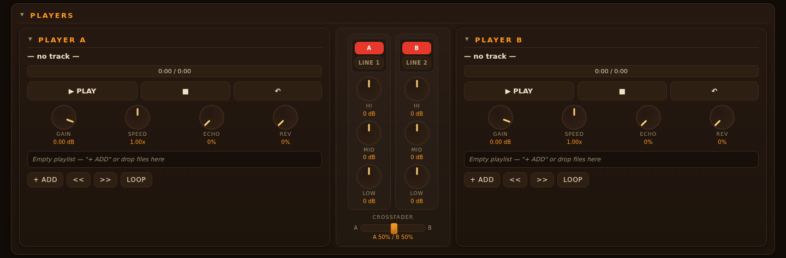

## Kill switches — 4-band ISO filter

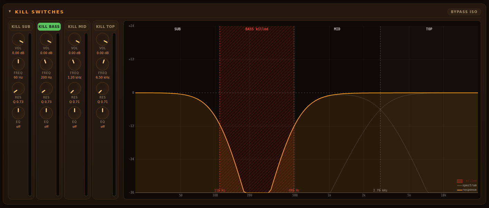

The ISO filter splits the signal into 4 true bands (24 dB/oct per edge,
allpass-compensated cascade summing): each band lives around its **FREQ** centre,
and the edges sit at the geometric midpoint between neighbouring centres — SUB
below the SUB/BASS midpoint, BASS between the SUB/BASS and BASS/MID midpoints, MID
between the BASS/MID and MID/TOP midpoints, TOP above the MID/TOP midpoint.

Under each kill:

- **FREQ** — the band centre (all four bands have it, TOP included).
- **RES** — resonance added to the Butterworth base of the edges and of the EQ
  bell. At 0 the sum of the 4 bands is mathematically flat: the output is exactly
  the source, with no colouring. Raise it for the "singing kill".
- **VOL** — −inf to +6 dB: the band level, usable without killing.
- **EQ** — the gain of the band's parametric EQ, a bell centred on FREQ: at 0 the
  EQ is off, negative scoops, positive boosts, ±15 dB.

The kill fully cuts its band (minus infinity — nothing gets through) and stiffens
the edges of the neighbouring bands toward its zone (48 dB/oct instead of 24): even
frequencies near the edges stop passing, the cut is hard with no leak.

Each band's vertical meter shows its energy: calibrated to fill ~90% at normal
volume (measured on the player bus after the dub filter and the ISO, independent of
master volume — siren, sampler and mic don't light these meters, only the master VU
reacts to their sound). Fixed colours: green up to 50%, yellow from 50 to 90%, red
above 90% — and the meter goes dark when you kill that band.

**Routing:** the ISO filter and the dub filter only process the players and line
inputs (LINE 1 / LINE 2 selected in the channels) — siren, sampler and mic run
direct, and the echo/reverb returns go straight to the master, out of the ISO and
the dub filter.

**The module graph** makes all of this visible: the live spectrum of the player bus
(pale curve) and the response of the 4 bands rebuilt from your settings (orange
curve, filled area = what passes) — the three vertical dashes are the edges (they
follow the FREQ knobs and turn red on the killed side), RES swells the bumps as the
edges pass, the EQ bell shows on its band, and a killed band collapses to the floor
with red hatching while its neighbours' edges dive steeper — the live spectrum digs
a hole exactly there.

The **BYPASS ISO** button (right of the title, kept at the far right of the bar
when the module is folded) takes the whole ISO out of the signal path in one click:
the output becomes the exact dry path taken after the dub filter (the graph goes
flat, whatever the settings and kills), and the band meters keep showing the energy
each band processes behind the scenes.

## Dub filter

Isolator-style low-pass / high-pass: **CUTOFF** and **RES**, plus an **LFO** (rate +
depth) for automatic sweeps. Sweep the filter during the echo for the "dub drop".
Only processes the players and line inputs (A/B channels) — siren, sampler, mic and
echo/reverb returns run direct (the returns go straight to the master).

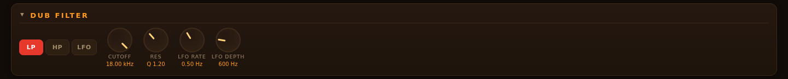

## Tape echo

Tape style: tape saturation + wow & flutter in the loop, repeats degrade like a
real tape echo.

- **TIME** (fader), **FEEDBACK**, **CUTOFF / RESO** (resonant filter in the loop),
  **DW** (echo/dry blend), **SAT** (tape saturation), **WOW** (wow & flutter).
- **SLIDE** — the time "glides" when you change it (the pitch drags down with it,
  like tape).
- **TAP** — learns the tempo by tapping (or the space bar) and sets the echo to it.
- **DIV** — tempo division for the echo time: 1/16, 1/8, 1/4 (one beat), 1/2 or 1
  (one bar); change the division and the time recomputes from the last tapped tempo.
- **PING-PONG** switches to alternating stereo echoes, **FILTER 2** adds extra
  filtering on the repeats, **LIMITER** protects the return, **ON** arms the module.

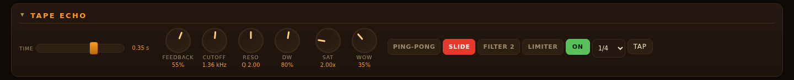

## Reverb

**ROOM** = room size, **DAMP** = HF damping (warm tail), **CUTOFF / RESO** =
resonant filter on the return, **DW** = reverb/dry blend. **FILTER 2** fine-tunes
the return, **LIMITER** protects it, **ON** arms the module.

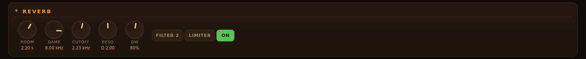

## Master & monitors

**MASTER** volume, **LIMITER**, and the echo and reverb return levels
(**ECHO RTN / REV RTN**) — the returns go straight to the master, out of the ISO and
the dub filter. The **VU L/R** and **Spectrum** monitors measure the master output.

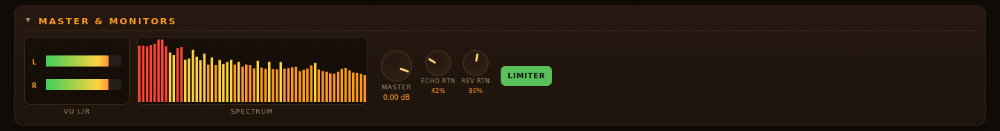

## Dub siren

Hold **FIRE** to play (or the `S` key); when the module is folded, a small red FIRE
stays in its title bar. Preset and waveform in dropdown menus, **CHOP** for rhythmic
gating. Settings in 3 zones:

- **SYNTH & DEGRADE** — BASE, SIN/SQR RATE & DEPTH, BITS / S.RATE.
- **GAIN & TONE** — level and filter.
- **FX SENDS** — ECHO SEND / REV SEND.

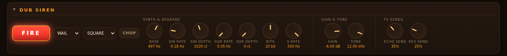

## Sampler

12 pads × 4 sets: click an empty pad (or drop a file on it) to load a sample, click
again to play it. Settings: **GAIN**, **HPF** (high-pass), **ECHO** and **REV**
sends. Pad keys: `Z X C V B N M , . ; / '` for pads 1 to 12.

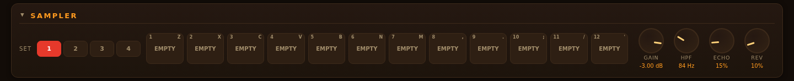

## Mic

Enable it with the **MIC** button at the top: built-in high-pass (85 Hz default,
adjustable), mic gain, low / mid / high EQ (same bands as the channels: 150 Hz,
1 kHz, 4 kHz, ±12 dB), parametric bell **FREQ / RES / GAIN** to scoop or highlight a
specific frequency, and echo/reverb sends for on-the-fly toasting. The module sits
at the top, on one line in three zones: gain & EQ, parametric EQ, FX sends.

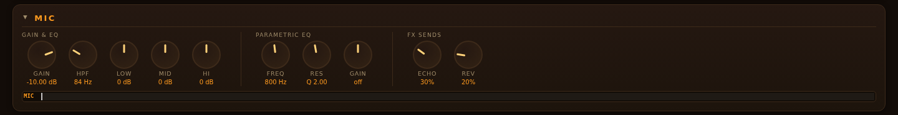

## 10-band graphic EQ

±12 dB per band, 32 Hz to 16 kHz; **RESET** flattens everything. It sits after the
ISO: it processes the players and line inputs, but also the siren, sampler and mic
(everything feeding the master) — only the echo/reverb returns skip it, they go
straight to the master.

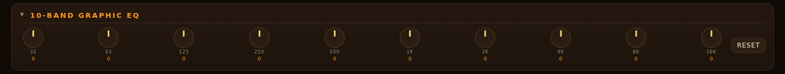

## Classic dub flow

1. Cut TOP with its KILL (or scoop with the EQ10).
2. Raise the echo time and FEEDBACK.
3. Send the track to the echo (the player's ECHO knob).
4. Sweep the DUB FILTER (LP/HP) or turn its LFO on.
5. Release FIRE (pick a preset: WAIL, CHOP, YELP… add BITS / S.RATE degrade for
   grit and raise REV SEND to pin it in space).
6. Fire samples.

The echo repeats go through tape saturation + the resonant filter: they get darker
every pass, like on a real tape echo.

## Keyboard shortcuts

| Key | Action |
| --- | --- |
| `?` | open the help |
| `Q` / `P` | play / pause player A / B |
| `1` `2` `3` `4` | kills SUB / BASS / MID / TOP |
| `5` | toggle LP / HP (dub filter) |
| `F` | filter LFO on / off |
| `E` | ping-pong on / off |
| `Space` | echo TAP (learn tempo) |
| `S` | siren (hold) |
| `Z` `X` `C` `V` `B` `N` `M` `,` `.` `;` `/` `'` | pads 1–12 |
| `←` / `→` | crossfader |
| `Esc` | close the help |

## MIDI

Plug your controller (Akai MIDImix…), click **MIDI**, then click a control and move
a knob / press a pad. The mapping is saved in the browser.

## Presets & saving

**SAVE** exports all settings as JSON (and everything is kept locally
automatically). **LOAD** restores. The sampler and the playlists fill by drag & drop;
the files themselves can't be remembered by the browser between sessions (security):
keep your sample folders at hand.

## Built-in help

The `?` button (top right) opens the full help window — the same documentation as
this README, built into the app. It is written in English by default, and the
**FRANÇAIS** button switches it to French at any time.

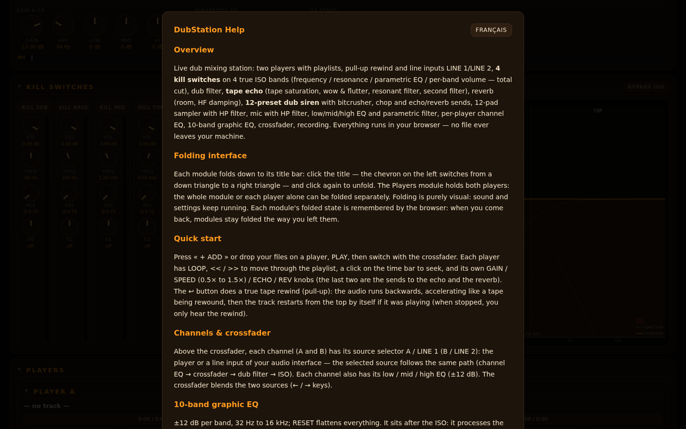

## Privacy

Everything runs locally in your browser. Your audio files, samples and settings
never leave your machine — there is no server, no upload, no analytics.

---

**DubStation V1.0** — [open it](https://altessproduction.github.io/DUBSTATION/), [download it](https://github.com/altessproduction/DUBSTATION/releases/download/v1.0/DubStation.V1.0.html) or [install it](#open-download-or-install-it) — one file, one click, pure dub.

